# Architecture class diagram

```mermaid
classDiagram
    direction TB
    class shell_AgentShell["AgentShell"] {
        -_adapter: AgentAdapter
        +execution_host: ExecutionHost
        +isolation_policy: IsolationPolicy
        +open_interactive(cwd: str, ...) InteractiveSession
        +attach_interactive(target: object) InteractiveConnection
        +execute(cwd: str, prompt: str, ...) AgentResponse
        +stream(cwd: str, prompt: str, ...) AsyncIterator~StreamEvent~
        +health_check(cwd: str, model: Optional~str~, ...) HealthCheckResult
        +list_models(cwd: str, timeout: float) list~str~
        +add_mcp_server(mcp_server: MCPServerSpec) None
        +remove_mcp_server(mcp_server_name: str) None
        +list_mcp_servers() list~MCPServerSpec~
        +add_package(package: PackageSpec, timeout: float) None
        +list_packages() list~PackageSpec~
        +remove_package(source: str, timeout: float) None
    }

    class protocol_AgentAdapter["AgentAdapter"] {
        <<Protocol>>
        +execute(cwd: str, prompt: str, ...) AgentResponse
        +stream(cwd: str, prompt: str, ...) AsyncIterator~StreamEvent~
        +cancel() None
        +health_check(cwd: str, model: Optional~str~, ...) HealthCheckResult
        +list_models(cwd: str, timeout: float) list~str~
        +add_mcp_server(mcp_server: MCPServerSpec) None
        +remove_mcp_server(mcp_server_name: str) None
        +list_mcp_servers() list~MCPServerSpec~
        +add_package(package: PackageSpec, timeout: float) None
        +list_packages() list~PackageSpec~
        +remove_package(source: str, timeout: float) None
    }

    class claude_ClaudeCodeAdapter["ClaudeCodeAdapter"] {
        -_active_processes: list~RunHandle~
        -_execution_host: ExecutionHost
        -_isolation_policy: IsolationPolicy
        +validate_interactive(allowed_tools: Optional~StringList~) None
        +prepare_interactive(directory: Path, ...) InteractiveLaunch
        +parse_interactive_event(event: dict) list~StreamEvent~
        +execute(cwd: str, prompt: str, ...) AgentResponse
        +stream(cwd: str, prompt: str, ...) AsyncIterator~StreamEvent~
        +cancel() None
        +list_models(cwd: str, timeout: float) list~str~
        +add_mcp_server(mcp_server: MCPServerSpec) None
        +remove_mcp_server(mcp_server_name: str) None
        +list_mcp_servers() list~MCPServerSpec~
        -_parse_event(event: dict, include_thinking: bool) list~StreamEvent~
    }

    class models_AgentExecutionError["AgentExecutionError"] {
        <<Exception>>
        +reason: str
        +response: str
        +cost: float
        +session_id: Optional~str~
        +duration: float
        +output_tokens: int
        +returncode: Optional~int~
        +signal: Optional~int~
    }

    class resources_SessionResources["SessionResources"] {
        <<dataclass>>
        +skills: list~str~
        +plugins: list~str~
        +extensions: list~str~
        +packages: list~PackageSpec~
        +mcp_servers: Optional~MCPServerList~
        +inherit_personal_resources: bool
        +inherit_project_resources: bool
        +include_instruction_files: bool
        +include_home_system_prompt: bool
    }

    class portresources_ResourceAdapter["ResourceAdapter"] {
        <<Protocol>>
        +prepare_resources(resources: SessionResources, cwd: str, ...) ResourceLaunch
    }

    class portresources_ResourceLaunch["ResourceLaunch"] {
        <<dataclass>>
        +arguments: list~str~
        +env: StringMap
    }

    class models_PackageSpec["PackageSpec"] {
        <<dataclass>>
        +source: str
    }

    class models_MCPServerSpec["MCPServerSpec"] {
        <<dataclass>>
        +name: str
        +type: MCPServerType
        +command: Optional~str~
        +args: list~str~
        +env: StringMap
        +url: Optional~str~
        +headers: StringMap
    }

    class models_MCPServerType["MCPServerType"] {
        <<StrEnum>>
        STDIO
        HTTP
    }

    class models_AgentResponse["AgentResponse"] {
        <<dataclass>>
        +response: str
        +cost: float
        +session_id: Optional~str~
        +duration: float
        +output_tokens: int
    }

    class models_HealthCheckResult["HealthCheckResult"] {
        <<dataclass>>
        +healthy: bool
        +exception: Optional~str~
    }

    class models_StreamEvent["StreamEvent"] {
        <<dataclass>>
        +type: str
        +content: str
        +cost: float
        +duration: float
        +session_id: Optional~str~
        +output_tokens: int
        +error: Optional~str~
        +returncode: Optional~int~
        +signal: Optional~int~
    }

    class portexecution_ExecutionHost["ExecutionHost"] {
        <<Protocol>>
        +launch(command: list~str~, cwd: str, ...) RunHandle
    }

    class execution_NativeExecutionHost["NativeExecutionHost"] {
        +launch(command: list~str~, cwd: str, ...) NativeRunHandle
    }

    class herdr_HerdrExecutionHost["HerdrExecutionHost"] {
        <<experimental>>
        +launch(command: list~str~, cwd: str, ...) RunHandle
    }

    class tmux_TmuxExecutionHost["TmuxExecutionHost"] {
        <<experimental>>
        +launch(command: list~str~, cwd: str, ...) RunHandle
        +launch_interactive(command: list~str~, cwd: str, ...) TmuxTerminalSession
        +attach_interactive(target: object) TmuxTerminalConnection
    }

    class window_TerminalWindowExecutionHost["TerminalWindowExecutionHost"] {
        <<experimental>>
        +launch(command: list~str~, cwd: str, ...) TerminalWindowRunHandle
    }

    class portinteractive_InteractiveAdapter["InteractiveAdapter"] {
        <<Protocol>>
        +validate_interactive(allowed_tools: Optional~StringList~) None
        +prepare_interactive(directory: Path, ...) InteractiveLaunch
    }

    class portinteractive_InteractiveLaunch["InteractiveLaunch"] {
        <<dataclass>>
        +command: list~str~
        +parse_event: EventParser
        +capabilities: frozenset~str~
        +env: Optional~StringMap~
        +event_path: Optional~EventPath~
        +event_offset: int
    }

    class portinteractive_InteractiveExecutionHost["InteractiveExecutionHost"] {
        <<Protocol>>
        +launch_interactive(command: list~str~, cwd: str, ...) InteractiveTerminal
    }

    class portinteractive_TerminalControl["TerminalControl"] {
        <<Protocol>>
        +closed: bool
        +capture_screen() str
        +send_text(text: str, submit: bool) None
        +send_key(key: str) None
        +close() None
    }

    class portinteractive_InteractiveTerminal["InteractiveTerminal"] {
        <<Protocol>>
        +returncode: Optional~int~
        +resize(columns: int, rows: int) None
        +wait() int
    }

    class portinteractive_InteractiveAttachmentHost["InteractiveAttachmentHost"] {
        <<Protocol>>
        +attach_interactive(target: object) TerminalControl
    }

    class interactive_InteractiveConnection["InteractiveConnection"] {
        <<experimental>>
        +terminal: TerminalControl
        +close() None
        +\_\_aenter\_\_() InteractiveConnection
        +\_\_aexit\_\_(...) None
    }

    class tmux_TmuxTarget["TmuxTarget"] {
        <<dataclass>>
        +socket_path: str
        +pane_id: str
        +server_pid: int
        +server_started: int
        +pane_pid: int
        +capture(pane_id: str, socket_path: Optional~str~) TmuxTarget
        +current() TmuxTarget
    }

    class terminal_TmuxTerminalConnection["TmuxTerminalConnection"] {
        +target: TmuxTarget
        +attach(target: object) TmuxTerminalConnection
    }

    class terminal_TmuxTerminalSession["TmuxTerminalSession"]

    class interactive_InteractiveSession["InteractiveSession"] {
        <<experimental>>
        +terminal: InteractiveTerminal
        +capabilities: frozenset~str~
        +events() AsyncIterator~StreamEvent~
        +close() None
        +\_\_aenter\_\_() InteractiveSession
        +\_\_aexit\_\_(...) None
    }

    class window_TerminalWindowRunHandle["TerminalWindowRunHandle"]

    class portexecution_PreparedLaunch["PreparedLaunch"] {
        <<dataclass>>
        +command: list~str~
        +env: Optional~StringMap~
        +pass_fds: IntTuple
        +reported_status_fd: Optional~int~
        +close_after_spawn: IntTuple
        +spawned() None
        +failed() None
    }

    class portexecution_IsolationPolicy["IsolationPolicy"] {
        <<Protocol>>
        +prepare(command: list~str~, env: Optional~StringMap~) PreparedLaunch
    }

    class execution_NoIsolation["NoIsolation"]
    class execution_LinuxPidNamespaceIsolation["LinuxPidNamespaceIsolation"]

    class portexecution_RunHandle["RunHandle"] {
        <<Protocol>>
        +pid: int
        +returncode: Optional~int~
        +wait() int
        +communicate(input: Optional~bytes~) BytePair
        +cancel() None
        +release() None
    }

    class execution_NativeRunHandle["NativeRunHandle"]

    class models_AgentType["AgentType"] {
        <<StrEnum>>
        CLAUDE_CODE
        OPENCODE
        COPILOT_CLI
        CODEX
        PI
        CURSOR
        GROK
    }

    claude_ClaudeCodeAdapter --> portexecution_ExecutionHost : holds
    claude_ClaudeCodeAdapter --> portexecution_IsolationPolicy : holds
    claude_ClaudeCodeAdapter --> portexecution_RunHandle : tracks active runs
    portexecution_ExecutionHost ..> portexecution_RunHandle : returns
    portexecution_ExecutionHost ..> portexecution_IsolationPolicy : accepts
    portexecution_IsolationPolicy ..> portexecution_PreparedLaunch : returns
    execution_NativeExecutionHost ..> portexecution_PreparedLaunch : uses
    window_TerminalWindowExecutionHost ..> window_TerminalWindowRunHandle : creates
    window_TerminalWindowRunHandle ..|> portexecution_RunHandle : satisfies
    shell_AgentShell --> protocol_AgentAdapter : holds
    shell_AgentShell --> portexecution_ExecutionHost : holds
    shell_AgentShell --> portexecution_IsolationPolicy : holds
    execution_NativeExecutionHost ..|> portexecution_ExecutionHost : satisfies
    herdr_HerdrExecutionHost ..|> portexecution_ExecutionHost : satisfies
    tmux_TmuxExecutionHost ..|> portexecution_ExecutionHost : satisfies
    window_TerminalWindowExecutionHost ..|> portexecution_ExecutionHost : satisfies
    execution_NativeExecutionHost ..> execution_NativeRunHandle : creates
    execution_NativeRunHandle ..|> portexecution_RunHandle : satisfies
    execution_NoIsolation ..|> portexecution_IsolationPolicy : satisfies
    execution_LinuxPidNamespaceIsolation ..|> portexecution_IsolationPolicy : satisfies
    shell_AgentShell ..> resources_SessionResources : accepts for launch
    resources_SessionResources ..> models_PackageSpec : selects
    resources_SessionResources ..> models_MCPServerSpec : selects
    protocol_AgentAdapter --|> portresources_ResourceAdapter
    portinteractive_InteractiveAdapter --|> portresources_ResourceAdapter
    portresources_ResourceAdapter ..> portresources_ResourceLaunch : prepares
    claude_ClaudeCodeAdapter ..> portresources_ResourceLaunch : translates into launch
    shell_AgentShell ..> models_AgentType : resolves via
    claude_ClaudeCodeAdapter ..|> protocol_AgentAdapter : satisfies
    shell_AgentShell ..> models_AgentResponse : returns on success
    shell_AgentShell ..> models_AgentExecutionError : raises on failure
    shell_AgentShell ..> models_HealthCheckResult : returns
    shell_AgentShell ..> models_StreamEvent : yields
    shell_AgentShell ..> models_MCPServerSpec : accepts/returns
    shell_AgentShell ..> models_PackageSpec : accepts/returns
    models_MCPServerSpec --> models_MCPServerType : typed by
    claude_ClaudeCodeAdapter ..> models_StreamEvent : parses NDJSON into
    shell_AgentShell ..> portinteractive_InteractiveAttachmentHost : attach requires
    shell_AgentShell ..> interactive_InteractiveConnection : returns on attach
    interactive_InteractiveConnection --> portinteractive_TerminalControl : borrows
    portinteractive_InteractiveTerminal --|> portinteractive_TerminalControl
    tmux_TmuxExecutionHost ..|> portinteractive_InteractiveAttachmentHost : satisfies
    portinteractive_InteractiveAttachmentHost ..> portinteractive_TerminalControl : returns
    tmux_TmuxExecutionHost ..> terminal_TmuxTerminalConnection : attaches
    tmux_TmuxExecutionHost ..> tmux_TmuxTarget : accepts
    terminal_TmuxTerminalConnection ..|> portinteractive_TerminalControl : satisfies
    terminal_TmuxTerminalConnection --> tmux_TmuxTarget : identifies pane
    terminal_TmuxTerminalSession --|> terminal_TmuxTerminalConnection
    shell_AgentShell ..> portinteractive_InteractiveAdapter : requires
    shell_AgentShell ..> portinteractive_InteractiveExecutionHost : requires
    shell_AgentShell ..> interactive_InteractiveSession : returns
    claude_ClaudeCodeAdapter ..|> portinteractive_InteractiveAdapter : satisfies
    portinteractive_InteractiveAdapter ..> portinteractive_InteractiveLaunch : prepares
    portinteractive_InteractiveLaunch ..> models_StreamEvent : parser produces
    tmux_TmuxExecutionHost ..|> portinteractive_InteractiveExecutionHost : satisfies
    portinteractive_InteractiveExecutionHost ..> portinteractive_InteractiveTerminal : launches
    portinteractive_InteractiveExecutionHost ..> portexecution_IsolationPolicy : accepts
    tmux_TmuxExecutionHost ..> terminal_TmuxTerminalSession : creates
    terminal_TmuxTerminalSession ..|> portinteractive_InteractiveTerminal : satisfies
    interactive_InteractiveSession --> portinteractive_InteractiveTerminal : owns
    interactive_InteractiveSession ..> portinteractive_InteractiveLaunch : uses
    interactive_InteractiveSession ..> models_StreamEvent : yields
```

Diagram conventions:
- This is a selected API/relationship view, not a complete member or call graph. `self`/`cls`,
  defaults, keyword-only markers, constructors, and most internal members are omitted. `...` means
  omitted parameters, not a variadic argument. Empty boxes do not mean empty implementations.
- `+`/`-` denote public/internal naming conventions, not enforced Python access controls.
  Backslashes escape dunder underscores for rendering; they are not part of Python method names.
  `..|>` denotes structural Protocol conformance, not inheritance. Package methods may satisfy
  the interface by raising `NotImplementedError`; `PackageSpec` and `TmuxTarget` are frozen
  dataclasses. `--|>` denotes actual inheritance, including protocol inheritance.
- Methods are async except `validate_interactive()`, `prepare_interactive()`, event parsers,
  `release()`, and
  `PreparedLaunch.spawned()`/`failed()`. `stream()` and `events()` return async iterators;
  coroutine return types show the awaited value. `RunHandle.pid`/`returncode` are read-only
  properties, as is `TmuxTerminalConnection.target`. Stream properties and other
  implementation-specific terminal/handle members are omitted.
- Unannotated types shown for stored fields and the concrete `open_interactive()`,
  `prepare_interactive()`, and tmux `launch_interactive()`/`attach_interactive()` returns
  are inferred from assignments and return expressions, not assumed from missing annotations.
- `Optional~T~` means `T | None`; Mermaid tildes represent Python generic brackets.
  Diagram-only aliases: `StringMap` = `dict[str, str]`; `BytePair` = `tuple[bytes, bytes]`;
  `IntTuple` = `tuple[int, ...]`; `EventParser` = `Callable[[dict], list[StreamEvent]]`;
  `EventPath` = `Callable[[], Path | None]`; `MCPServerList` = `list[MCPServerSpec]`;
  `StringList` = `list[str]`.
- Omitted execution options: `execute()`/`stream()` accept `allowed_tools`, `disallowed_tools`
  (`list[str] | None`), `resources: SessionResources | None`, `model`, `effort`,
  `session_id` (`str | None`), and `include_thinking`,
  `auto_approve` (`bool`). `health_check()` also accepts `timeout: float` and `effort: str | None`.
- `open_interactive()`/`prepare_interactive()` options are `prompt`, `model`, `effort`,
  `session_id` (`str | None`) and `allowed_tools: list[str] | None`. Public `open_interactive()`
  also accepts `resources: SessionResources | None`. Internal execution/interactive adapters accept
  a prepared `resource_launch: ResourceLaunch | None`. Host `launch()` options
  are `env: StringMap | None`, `stdin: int`, and `isolation_policy: IsolationPolicy | None`;
  `launch_interactive()` accepts the same options except `stdin`.

Box ID prefixes identify declaring modules under `src/agent_shell/`: `shell`, `execution`,
`herdr`, `tmux`, and `interactive` map to their same-named `.py` files; `protocol` maps to
`ports/agent.py`, `portexecution` to `ports/execution.py`, and `portinteractive` to
`ports/interactive.py`; `portresources` maps to `ports/resources.py`, and `resources` to
`models/resources.py`. `claude` maps to `adapters/claude_code_adapter.py`, `models` to
`models/agent.py`, `window` to `terminal_window.py`, and `terminal` to `interactive_terminal.py`.

The [dependency boundary guide](dependency_boundaries.md) documents enforced import contracts
and their limits. Ports have dedicated modules so shared workflows can import them without
depending on concrete hosts. The old `execution`, `interactive`, and agent-adapter protocol
module paths continue re-exporting the same contract objects for compatibility.

The adapter pattern uses Python's `Protocol` (structural typing) rather than ABC, so adapters
satisfy the contract implicitly without inheritance. Each adapter translates agent-specific CLI
flags and NDJSON output into the shared `StreamEvent`/`AgentResponse` models, while the selected
`ExecutionHost` owns process creation and returns a per-run `RunHandle`.

The diagram uses `ClaudeCodeAdapter` as the representative adapter. All seven adapters satisfy
both `AgentAdapter` and `InteractiveAdapter`; interactive event capabilities differ by harness.
`open_interactive()` is experimental and requires a host satisfying `InteractiveExecutionHost`.
Currently only `TmuxExecutionHost` supports it, and only with `NoIsolation`. The adapter supplies
an `InteractiveLaunch` containing the command, event parser, capabilities, and optional event
source; the host owns terminal transport. `InteractiveSession.events()` reads structured events,
never terminal screen text. Callers own the session and must close it or use `async with`.

`attach_interactive(target)` is a separate, optional `InteractiveAttachmentHost` capability;
it does not require an interactive-launch-capable adapter or host. Initially only
`TmuxExecutionHost` implements it. Unsupported hosts raise `NotImplementedError`, mismatched
targets raise `TypeError`, and non-`NoIsolation` policies raise `IsolationUnavailableError`:
attachment cannot apply isolation to an existing process. There is no fallback launch or resume.

A `TmuxTarget` is captured by exact pane ID (optionally with an explicit socket), via `current()`
in the target's environment, or through a launched tmux terminal's `.target`. That property is
specific to `TmuxTerminalConnection`, not the portable terminal protocol. The target records server
PID, server start time, and pane PID as well as the socket/pane address. Attachment and later
pane operations check those identities on the tmux server and reject missing, dead, or replaced
panes.
The pane PID is its first process, not necessarily the agent: a shell may survive agent exit.
Callers remain responsible for the foreground application, human drafts, and agent readiness.

`InteractiveConnection` exposes only `TerminalControl` (input, inspection, and disconnect), without
structured events, process waiting, resizing, or exit status. `TmuxTerminalConnection` implements
that transport; `TmuxTerminalSession` adds launched-process ownership and retains its existing
cleanup behaviour. Closing a borrowed connection never signals or removes the external process
or pane. Closing its original owning session still stops it. Input queueing is native agent
behaviour, not an AgentShell guarantee; input delivery is not completion acknowledgement. Paste
and Enter are separate operations and are not automatically retried after partial failure.

`HerdrExecutionHost`, `TmuxExecutionHost`, and `TerminalWindowExecutionHost` are experimental,
opt-in APIs. Their constructors, placement options, supported platforms, and lifecycle behaviour
may change in a later minor release. `NativeExecutionHost` remains the backwards-compatible
default, and an unavailable experimental host never silently falls back to it.

Execution location and protection are separate axes. Existing callers default to
`NativeExecutionHost()` plus `NoIsolation()` when `AGENTSHELL_ISOLATION_POLICY` is unset. The
environment accepts `none` or `linux-pid-namespace` as a process-wide construction default;
explicit `isolation_policy=` takes precedence, and invalid or empty values raise `ValueError`.
`LinuxPidNamespaceIsolation` is a direct signal boundary: a tiny init/reaper is PID 1 and the CLI
is PID 2 or later, so child-namespace processes cannot directly signal AgentShell's ancestors.
The default `mount_proc=True` also hides those ancestors through a private `/proc` mount.
Explicit `mount_proc=False` retains the PID boundary and descendant cleanup while inheriting the
outer `/proc` view, exposing process metadata and potentially confusing tools that use its PIDs.
It does not create a private mount namespace. The environment value `linux-pid-namespace` remains
strict; each policy probes its own requested mode. It requires Linux, `unshare`, and enabled
unprivileged user/PID namespaces; an unavailable request raises `IsolationUnavailableError` and
never falls back. This is not a general sandbox and does not restrict filesystem, credentials,
network, tools, or resources. The host/policy applies to
`execute()`, `stream()`, and `health_check()`; model discovery and MCP configuration remain local.

`output_tokens` is a cost measure — the billed output-token count, which **includes reasoning
tokens** (billed at the output rate). Each adapter normalises this so the value is consistent across
agents (e.g. OpenCode reports reasoning in a sibling field, so its adapter adds it back).

`health_check(cwd, model, timeout)` probes an agent + model combination with a trivial prompt
and returns `HealthCheckResult(healthy, exception)`. The verdict is derived from the normalised
event stream (healthy = the LAST `result` event says `content == "ok"` and no `error` event
arrived — pi emits one `result` per agent loop, and its auto-retry runs more than one), not exit
codes — which are unreliable, since some CLIs exit 0 on failure. `execute()` judges a run by the
same rule and raises `AgentExecutionError` when it fails, carrying whatever partial
response/cost/session/token data the run produced. The success/failure verdict lives once in
`adapters/outcome.py`, shared by both surfaces so they report identical reasons for the same
stream; `adapters/health.py` wraps it for the health probe, and `adapters/response.py` wraps it
for `execute()`'s stream-to-`AgentResponse` collection. Every adapter binds `execute` directly to
that shared collector. Adapters that reject interactive tool selections also bind the shared
`reject_interactive_tools` validator; adapters with native support retain their own validation.
`AgentShell.execute()` collects its own session-aware stream through the same aggregation function,
so selection records are written when a session ID arrives, even if execution is later cancelled.

`list_models(cwd, timeout)` asks the selected CLI for its current account/workspace-aware model
catalog and returns exact `list[str]` selectors that can be passed unchanged to `execute()` or
`stream()`. It sends no inference prompt, imports no harness SDK, invokes no separate refresh
command, and never substitutes a static catalog. "Available" means advertised as selectable; use
`health_check(model=...)` when actual execution must be proven.

Session resources use the provider-independent `SessionResources` model and the `ResourceAdapter`
port. Shared `resources.py` snapshots input, validates paths, owns temporary headless files, and
records a selection digest for resume. Each adapter prepares native arguments/environment and
retains ownership of CLI-specific formats and exclusions. Pi's protected `adapters/pi_resources.py`
helper owns native installation and cache locking; other adapters cannot import it.
Resource preparation uses the same async port signature across adapters, even when one implementation
only builds arguments or does not use every input. Pi awaits installation through that contract.

Interactive resource files share the observer directory's lifetime. Stream close awaits adapter
cleanup before deleting temporary configuration. Resources apply only to launched sessions;
attachment does not reconfigure a process. Adapter-owned interactive tool validation runs before
resource preparation, so unsupported tool options cannot trigger package installation. Resume
records are located by agent/session ID, with cwd checked as part of the selection digest. MCP server
identity uses sorted server names, excluding connection configuration and credentials from the digest.
Fresh calls without resources skip selection storage. Selected launches and resume checks use
`XDG_STATE_HOME` when set, falling back to the home directory; if neither can be resolved, they fail
before launch with instructions to set `XDG_STATE_HOME`.
The remaining selected paths, package sources and discovery/instruction switches must match. See the
[resource support matrix](../development/agent_parameter_comparison.md#per-session-resources)
for supported combinations, resume restrictions, and native authentication validation limits.
